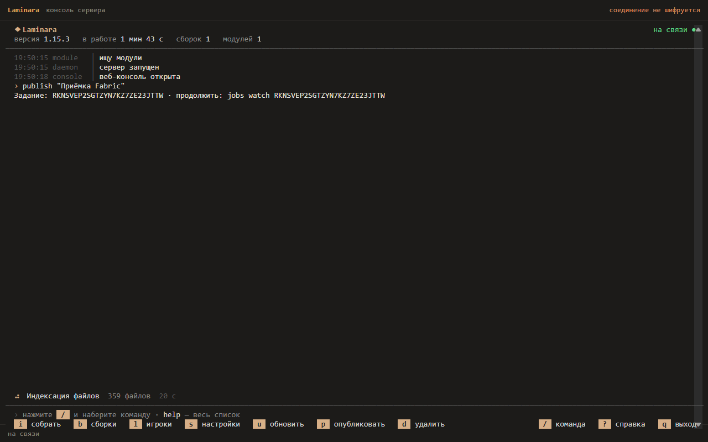
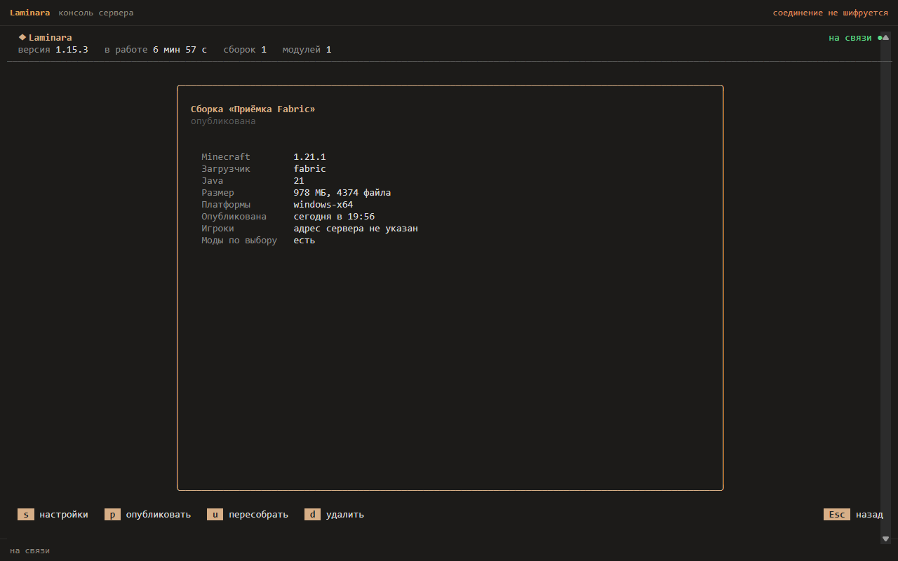

import { Aside, Steps } from "@astrojs/starlight/components";

Все платформы одной публикации переключаются вместе. Сервер сначала записывает полный
набор манифестов и подписей в каталог поколения, затем атомарно меняет указатель текущей
публикации. Ошибка до переключения оставляет игрокам предыдущую версию. Метаданные находятся
в `.laminara` внутри папки сборки; эту папку не включают в скачиваемые файлы.
Предыдущие поколения сохраняются: игроки с уже полученным манифестом могут закончить
скачивание старых объектов. Автоматическая очистка истории пока не выполняется.

`install` собирает папку профиля, но лаунчер о ней ничего не знает. Чтобы сборка стала доступна, её нужно опубликовать.

```sh
laminara-server exec publish <имя>
```

## Что делает publish

В консоли публикация запускается клавишей `p` из карточки сборки. Во время обхода
показываются фаза и число обработанных файлов; после завершения карточка содержит
размер, число файлов и время публикации.





Команда обходит папку профиля и составляет **манифест** — список всех файлов с их размерами и хешами. Манифест приводится к каноническому виду (файлы отсортированы, сериализация детерминированная) и подписывается ключом Ed25519 из `build.signingKeyPath`.

Подпись накладывается ровно на те байты, которые получит лаунчер. Он проверяет её по ним же, ничего не пересериализуя. Поэтому проверка не зависит ни от версии Laminara, ни от того, как манифест хранился и передавался.

## Что запрашивает лаунчер

При входе лаунчер получает от сервера список сборок и запрашивает манифест нужной:

<Steps>

1. **Проверка подписи**

   Лаунчер сверяет подпись манифеста с [набором ключей](/server/signing), записанным в него при сборке. Не сошлось ни с одним — сборка отвергается целиком.

2. **Сверка файлов**

   Для каждого файла из манифеста лаунчер смотрит, есть ли он локально с нужным хешем. Совпал — берётся из кеша, нет — ставится в очередь на скачивание.

3. **Докачивание**

   Недостающие файлы качаются по `/objects/<хеш>`. Каждый скачанный файл проверяется по хешу.

</Steps>

Отсюда быстрые обновления: при переходе на новую версию сборки лаунчер докачивает только изменившиеся файлы, а всё, что осталось прежним, у игрока уже лежит.

## Обновление сборки

Обновить сборку — это `install` (или правка файлов профиля вручную) и снова `publish`. Новый манифест заменяет старый; при следующем запуске лаунчер подтянет разницу.

Правка `laminara.settings.json` тоже вступает в силу только после `publish`: настройки подписываются в манифест вместе с файлами, и лаунчер не читает их с сервера отдельно.

Перед публикацией `publish` проверяет, что все платформы собраны последним `install`. Если одна отстала, публикация не состоится, а команда назовёт, чем её пересобрать, — подробнее в разделе [Платформы](/builds/preparing#платформы).

<Aside type="caution">
Публичный ключ подписи зашивается в лаунчер. Если вы потеряете приватный ключ (`build.signingKeyPath`), переподписать сборки будет нечем, а сменить ключ — значит выпустить новую версию лаунчера. Храните и бэкапьте этот файл отдельно.
</Aside>
