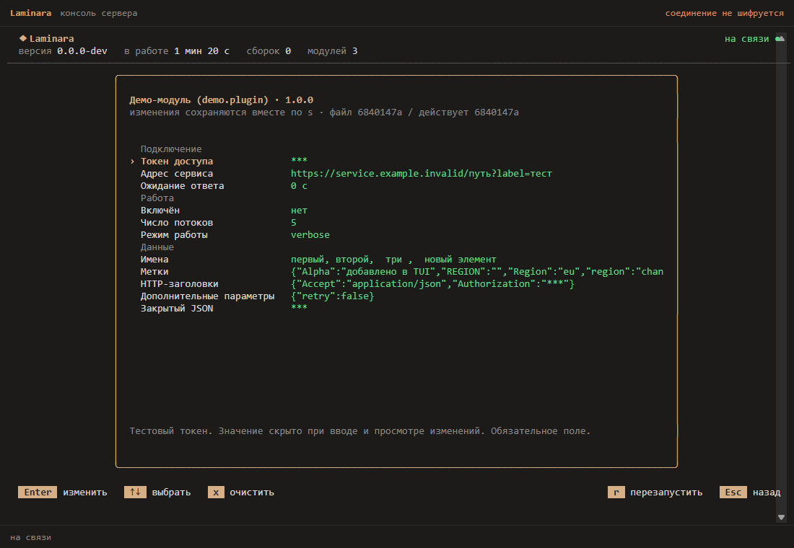
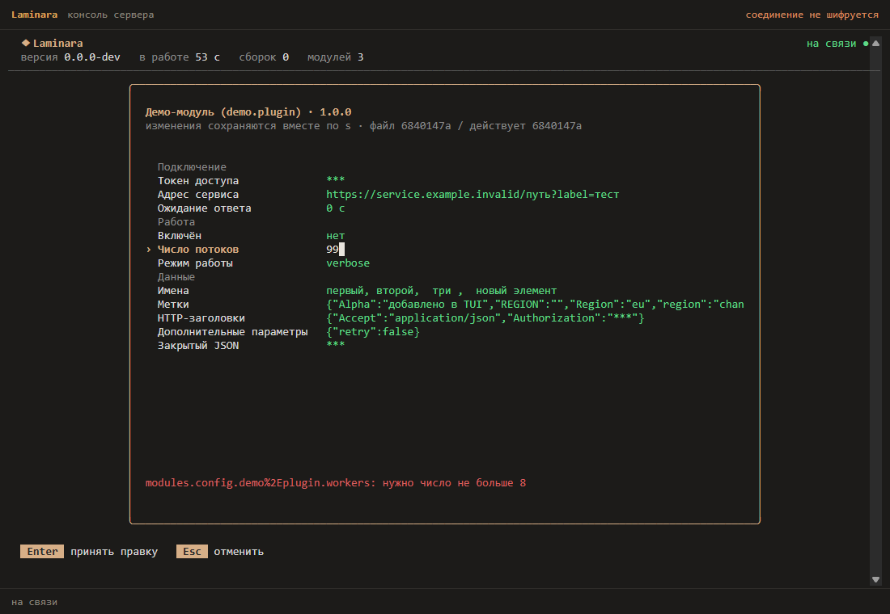
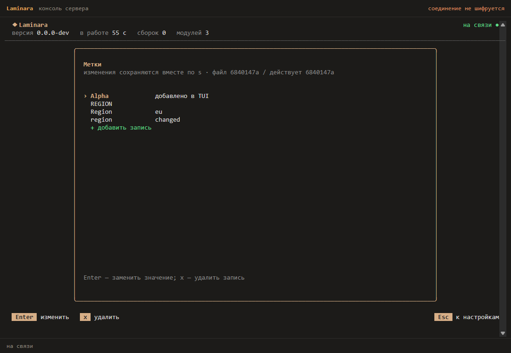

Модуль — это исполняемый файл, который сервер запускает отдельным процессом
и с которым общается по gRPC. Модуль добавляет команды в единый реестр
сервера, поэтому его команды появляются в CLI, консоли, `exec` и `help` наравне
со встроенными; он же может подписаться на события и отдать серверу свои
провайдеры — аутентификации, скинов, доступа к сборкам и новостей. Падение модуля
не роняет сервер, а писать модуль можно на любом языке, поддерживающем
gRPC-контракт (Go — из коробки, через SDK).

## Модуль на Go

SDK живёт отдельным Go-модулем `github.com/laminara/laminara/sdk/go`, поэтому
подключается одной строкой и не тянет за собой код сервера:

```bash
go get github.com/laminara/laminara/sdk/go
```

Реализуйте два метода — `Info()` и `Commands()`:

```go
package main

import (
	"context"
	"fmt"
	"io"
	"strings"

	module "github.com/laminara/laminara/sdk/go/module"
)

type greeter struct {
	greeting string
}

func (g *greeter) Info() module.Info {
	return module.Info{Name: "greeter", Version: "0.1.0", Description: "Пример модуля"}
}

func (g *greeter) Commands() []module.Command {
	return []module.Command{{
		Name:     "greet",
		Aliases:  []string{"hi"},
		Synopsis: "поприветствовать",
		Run: func(_ context.Context, args []string, out io.Writer) error {
			who := "мир"
			if len(args) > 0 {
				who = strings.Join(args, " ")
			}
			fmt.Fprintf(out, "%s, %s!\n", g.greeting, who)
			return nil
		},
	}}
}

func main() {
	module.Serve(&greeter{greeting: "Привет"})
}
```

`Run` пишет вывод в `out` — он стримится обратно тому, кто вызвал команду.

## Конфигурация

Чтобы модуль принимал настройки, реализуйте необязательный интерфейс
`Configure(config []byte) error` — сервер передаст блок конфигурации
(JSON-объект) перед регистрацией команд и обработчиков событий. Понадобится импорт `encoding/json`:

```go
func (g *greeter) Configure(config []byte) error {
	var settings struct {
		Greeting string `json:"greeting"`
	}
	if err := json.Unmarshal(config, &settings); err != nil {
		return err
	}
	if settings.Greeting != "" {
		g.greeting = settings.Greeting
	}
	return nil
}
```

### Настройка через TUI

На главном экране консоли нажмите `m`. Тот же список находится в
**Настройки проекта → Модули → Настройки модулей**. Он объединяет установленные
исполняемые файлы и сохранённые настройки. Создавать блок в JSON вручную не нужно.
Положите модуль в папку `modules.dir` и перезапустите сервер: список обновляется при запуске.

У каждого установленного модуля показано, загрузился ли он и доступны ли отдельные поля.
Модуль, которому не хватает обязательных параметров, остаётся в списке: откройте его,
заполните поля и нажмите `s`. Консоль покажет изменения и ошибки до записи. После
сохранения нужен перезапуск сервера (`r`); горячее применение настроек не поддерживается.
`x` на поле удаляет сохранённое значение, возвращая объявленный default, если он есть.
Поиск в общих настройках находит и поля модулей.

На снимках показан проверочный модуль с разными типами полей. У каждого модуля
свой набор настроек.



Проверка значения происходит при вводе. При ошибке текст остаётся в редакторе,
чтобы его можно было исправить. `Esc` отменяет ввод вместе с сообщением об ошибке.



В списке модулей действие «настроить по имени файла» создаёт только конфигурацию.
Сам файл модуля устанавливается отдельно. `x` сбрасывает настройки выбранного модуля
после подтверждения; исполняемый файл остаётся на месте.

Настройки остаются в основном `config.json`:

```json
{
  "modules": {
    "config": {
      "greeter": {
        "greeting": "Добро пожаловать"
      }
    }
  }
}
```

Ключ записи совпадает с **именем исполняемого файла**, а не с названием из `Info`.
Имя файла стабильно связывает сохранённые параметры с модулем; переименование файла
требует переноса соответствующего блока. Точки и пробелы в именах поддерживаются.
В технических путях Admin API точка внутри имени кодируется как `%2E`, процент как `%25`:
`modules.config.my%2Eplugin.greeting`. В самом JSON имя остаётся `my.plugin`.

Сохраняются только явно заданные значения. Изменение отдельного поля не удаляет
неизвестные модулю или новой схеме ключи. Секреты скрыты в ответах API и при просмотре
изменений; в конфиге они хранятся обычным текстом. Для внешнего хранения используйте
`${env:NAME}` или `${file:path}`. В режиме `external` доступны просмотр, подготовка
правок и экспорт; запись выполняется через внешний источник конфигурации.

### Описание полей в SDK

Реализуйте `module.SettingsDescriber`: метод `Settings() module.SettingsDescriptor`.
Описание не зависит от состояния терминала и подходит другим клиентам Admin API.

```go
func (g *greeter) Settings() module.SettingsDescriptor {
    return module.SettingsDescriptor{Module: []module.SettingField{
        {
            Key: "greeting", Label: "Приветствие", Group: "Сообщения",
            Kind: module.SettingText, Default: "Привет", Required: true,
            Hint: "Текст перед именем игрока в команде greet.",
        },
        {
            Key: "eventLog", Label: "Файл событий", Group: "Журнал",
            Kind: module.SettingText,
            Hint: "Пустое значение отключает запись событий.",
        },
    }}
}
```

Рабочий пример находится в `examples/modules/greeter/main.go` в исходниках.
SDK отправляет такое описание с `version: 1`. Сервер проверяет поля и подставляет
отсутствующие defaults перед `Configure`; в файл эти значения автоматически не записываются.
Явные `false`, `0` и пустые списки остаются явными значениями. После очистки поля
следующий запуск использует default из установленной версии модуля.

| Тип | Значение в конфиге | Редактор |
| --- | --- | --- |
| `text` | строка | текст |
| `secret` | строка | скрытый ввод |
| `bool` | JSON boolean | переключатель |
| `int` | целое число | ввод с проверкой `min` и `max` |
| `duration` | строка, например `10s` | длительность; `allowZero` разрешает ноль |
| `choice` | строка из `options` | выбор варианта |
| `list` | массив строк | добавление, правка и удаление элементов |
| `map` | объект со строковыми значениями | словарь с учётом регистра ключей |
| `pairs` | объект HTTP-заголовков | редактор заголовков со скрытием чувствительных значений |
| `json` | произвольное JSON-значение | многострочный JSON без маскирования |
| `secret-json` | произвольное JSON-значение | скрытая замена блока |

Словари и списки открываются отдельным экраном. После изменения элемента курсор
остаётся на нём; после добавления выбирается новая запись. `Esc` возвращает к исходному
полю формы. Длинные списки вариантов выбора прокручиваются внутри меню.



Для секретов используйте `secret` или `secret-json`; обычные `text`, `map` и `json`
считаются открытыми данными. Секретный default в схеме запрещён.

`key` задаёт путь внутри настроек модуля: `connection.timeout` создаёт вложенный объект.
`label` и `hint` описывают поле, `group` объединяет соседние поля под заголовком.
`required` запрещает пустое строковое значение и `null`; отсутствующее поле допустимо,
если у него есть default.
`options` обязателен для `choice`. Для целых чисел `min` и `max` включают границу;
в Go это указатели `*int64`, поэтому нулевая граница отличается от отсутствующей.
Default передаётся строкой: `"true"`, `"3"`, `"10s"`, для списка или словаря строка содержит JSON.

Схема ограничена 64 КиБ и 128 полями на модуль или провайдер. Пересекающиеся пути
(`server` и `server.token`), неизвестные типы, неподдерживаемые версии и неверные
defaults отклоняются. В этом случае сервер пишет причину в журнал, а TUI оставляет
скрытый JSON для ручной настройки. Сервер проверяет значения при сохранении и загрузке;
проверки соединений и предметных правил остаются в `Configure`.

### Как устроен контракт

Поток загрузки: `DescribeSettings → проверка схемы и параметров → Configure → Info`.
`DescribeSettings` возвращает метаданные и схему без регистрации команд и событий.
Поэтому `Info()`, `Settings()` и методы перечисления провайдеров должны работать до
`Configure` и не открывать соединения. Команды и обработчики становятся доступны
только после успешного `Configure`.

Если конфигурация отклонена, процесс останавливается, но описание остаётся в памяти
сервера до его перезапуска и доступно редактору. Незаданный блок нового модуля не
блокирует сохранение остальных настроек сервера. Уже созданный блок проверяется целиком:
обязательные поля можно заполнить одним набором правок и сохранить вместе.
Если не настроенный модуль выбран основным провайдером, например `auth.provider`,
сервер по-прежнему не запускается без рабочего провайдера. Сначала настройте модуль,
затем выбирайте его в качестве обязательного источника.

TUI получает поля через существующие `ListSettings` и `PreviewSettings`; изменения
отправляет через `ApplySettings`. В `SettingEntry` передаются тип, варианты, default,
группа, обязательность и числовые границы. Другой интерфейс использует тот же API,
проверку ревизии и серверный валидатор. Свой путь записи или запуск модулей UI не нужен.

Старый `SettingsSchemaJSON() []byte` остаётся доступен для совместимости и других языков.
Его формат такой же: `module` содержит массив полей, `providers` содержит схемы адаптеров.
Без `version` сохраняется прежняя семантика: defaults показывает редактор, а применяет
сам модуль. Для версии 1 defaults настроек модуля применяет сервер. Старые бинарники
без RPC `DescribeSettings` загружаются прежним порядком `Configure → Info`; для настройки
до первого успешного запуска пересоберите модуль с новым SDK.

### Настройки провайдеров

Объект `providers` описывает конфигурацию объявленных модулем провайдеров по ключам
`auth/имя`, `skin/имя`, `access/имя`, `news/имя`:

```json
{
  "version": 1,
  "providers": {
    "auth/mycms": [
      {"key":"url","label":"Адрес CMS","kind":"text","required":true},
      {"key":"token","label":"Токен","kind":"secret"},
      {"key":"timeout","label":"Тайм-аут","kind":"duration","default":"10s"}
    ]
  }
}
```

Эти поля находятся в настройках соответствующего адаптера (`auth.config` и другие),
а не в `modules.config`. Defaults провайдера применяет его фабрика `OpenAuth`, `OpenSkin`
и т. п. Поле `providers` не регистрирует новый провайдер само по себе: имя должно быть
объявлено соответствующим интерфейсом модуля.

### Секреты в командах

По умолчанию аргументы команды модуля скрыты из истории и эха TUI. Если они заведомо
не содержат секретов, установите `SafeArguments: true` в `module.Command`.
Для команды, возвращающей пароль или токен, установите `SecretOutput: true`: её вывод
получит только вызывающий клиент, без общего журнала. Такие команды выполняются
напрямую и не сохраняются в истории фоновых заданий. Разрыв соединения с ними
не поддерживает продолжение; остальные команды могут выполняться через jobs.

## События

Модуль может реагировать на события сервера — реализуйте `Events()` (список топиков)
и `OnEvent(ctx, topic, data)`:

```go
func (g *greeter) Events() []string {
	return []string{"build.published"}
}

func (g *greeter) OnEvent(_ context.Context, topic string, data map[string]string) error {
	fmt.Printf("%s: сборка %s\n", topic, data["name"])
	return nil
}
```

Доступные топики: `build.prepared`, `build.published`, `build.deleted`; имя сборки —
в `data["name"]`. Каждое событие доставляется подписанному модулю в отдельной
горутине, поэтому медленный модуль не блокирует сервер.

## Провайдеры

Модуль может отдать серверу провайдер — реализацию одного из адаптеров, которые
сервер выбирает по имени в конфиге. Провайдер модуля встаёт в тот же реестр, что и
встроенные, поэтому в конфиге он пишется ровно так же, как `jsonfile` или `http`:

| Вид | Интерфейс модуля | Где называется в конфиге |
|---|---|---|
| Аутентификация | `AuthProviders` + `AuthProvider` | `auth.provider` |
| Скины | `SkinProviders` + `SkinProvider` | `yggdrasil.skinProvider` |
| Доступ к сборкам | `AccessSources` + `AccessSource` | `access.sources.<имя>.type` |
| Новости | `NewsSources` + `NewsSource` | `news.source.type` |

Первый интерфейс перечисляет имена, второй — работает. Сервер запрашивает список
при загрузке модуля, а открывает провайдер тогда, когда доходит до него в конфиге,
и передаёт соседний блок настроек: для аутентификации это `auth.config`, для скинов
`yggdrasil.skinConfig`, для доступа и новостей — `config` рядом с `type`.

```go
func (m *cms) AuthProviders() []string { return []string{"mycms"} }

func (m *cms) OpenAuth(_ context.Context, name string, config []byte) (module.AuthProvider, error) {
	var settings struct {
		URL string `json:"url"`
	}
	if err := json.Unmarshal(config, &settings); err != nil {
		return nil, err
	}
	return &cmsAuth{url: settings.URL}, nil
}

func (a *cmsAuth) Authenticate(ctx context.Context, creds module.Credentials) (module.Identity, error) {
	switch verdict := a.ask(ctx, creds); verdict {
	case verdictWrongPassword:
		return module.Identity{}, module.ErrInvalidCredentials
	case verdictNeedsCode:
		return module.Identity{}, module.ErrTwoFactorRequired
	}
	return module.Identity{Subject: "42", Username: creds.Username, UUID: "..."}, nil
}
```

Две ошибки из SDK — `ErrInvalidCredentials` и `ErrTwoFactorRequired` — сервер понимает
как отдельные исходы: первая приводит к отказу и тратит бюджет попыток, вторая просит
лаунчер показать поле для кода из приложения-аутентификатора. Любая другая ошибка
считается сбоем модуля, а не неверным паролем. `UUID` — строка в обычном формате; если
модуль оставит её пустой, сервер посчитает офлайновый UUID от ника.

Имя провайдера должно быть свободным: занятое встроенным адаптером или другим модулем
имя сервер не примет и напишет об этом в журнал, а не подменит существующий провайдер
молча. Модули загружаются раньше, чем сервер читает конфиг, поэтому провайдер модуля
доступен уже при первом запуске — и виден в списке вариантов на экране настроек.

## Сборка и установка

Соберите модуль в обычный бинарь и положите его в каталог модулей сервера:

```bash
go build -o /var/lib/laminara/modules/greeter ./greeter
```

Укажите каталог и (необязательно) конфигурацию модулей в конфиге сервера —
ключ конфигурации совпадает с именем файла модуля:

```json config.json
{
  "modules": {
    "dir": "/var/lib/laminara/modules",
    "config": {
      "greeter": { "greeting": "Здорово" }
    }
  }
}
```

Блок `modules.config` — настройки самого модуля. Провайдер настраивается там, где
сервер его выбирает, поэтому модуль с провайдером аутентификации выглядит так:

```json config.json
{
  "modules": {
    "dir": "/var/lib/laminara/modules"
  },
  "auth": {
    "provider": "mycms",
    "config": { "url": "https://site.example/api" }
  }
}
```

Сервер подхватит модуль при запуске. Проверьте:

```
$ laminara-server exec "modules"
greeter          0.1.0    Пример модуля

$ laminara-server exec "greet Игорь"
Здорово, Игорь!

$ laminara-server status --json   # modulesLoaded увеличится
```

Команда модуля видна и в `help`, и в интерактивной консоли (наберите `/`, затем
имя команды). Устройство обмена — go-plugin: сервер запускает бинарь и говорит с ним
по gRPC. Контракт лежит в `proto/laminara/module/v1`, а сгенерированный по нему код
входит в SDK, поэтому модулю не нужны ни `buf`, ни кодогенерация.

### Модуль не поднялся

Сервер пишет причину в журнал и повторяет её в `laminara-server doctor --only modules`.

**«модулю негде создать свой сокет: временный каталог … только для чтения».** Модуль — отдельная
программа, и говорит она с сервером через unix-сокет во временном каталоге. Если unit systemd
написан с `ProtectSystem=strict`, но без `PrivateTmp=true`, `/tmp` доступен только для чтения. Сам
сервер в таком случае заводит `tmp/` рядом со своими данными и модули поднимаются как обычно —
эта ошибка означает, что запасной каталог тоже не получился. Перепишите unit тем, что печатает
сам сервер:

```sh
laminara-server systemd-config --config /etc/laminara/config.json \
  | sudo tee /etc/systemd/system/laminara-server.service
sudo systemctl daemon-reload && sudo systemctl restart laminara-server
```

**«модуль пропущен: файл не исполняемый».** `chmod +x` на файл модуля.

**«модуль не поздоровался с сервером».** Файл не модуль Laminara, собран под другую версию SDK или
падает при старте. Запустите его руками — модуль ответит `This binary is a plugin. These are not
meant to be executed directly.`; всё остальное на выходе и есть причина.

Владелец файла модуля роли не играет: сервер запускает его от своего пользователя, и достаточно
права на чтение и запуск. Строки `Owner:` и `Group:` в журнале — справка go-plugin, а не диагноз.

## Чем модуль может распоряжаться

Каталог модулей — то же доверие, что и сам бинарь сервера. Сервер запускает оттуда
**любой исполняемый файл** от своего пользователя: модуль читает те же файлы, ходит
в ту же базу и в ту же сеть. Изоляции нет — отдельный процесс нужен, чтобы падение
модуля не роняло сервер, а не чтобы ограничить его в правах.

Отсюда два правила:

- каталог принадлежит пользователю сервера и никому больше не пишется
  (`chown laminara: /var/lib/laminara/modules && chmod 750 …`). Кто может положить
  туда файл — тот выполняет код на вашем сервере;
- чужой модуль ставится так же, как любая программа на сервер: по исходникам, которые
  вы можете прочитать, из релиза, за который отвечает известный вам автор.

Провайдер аутентификации из модуля вдобавок решает, кого пускать: он видит логин и
пароль игрока в открытом виде и сам выносит вердикт. Это неизбежно для внешней CMS —
но модуль, который так делает, стоит выбирать особенно придирчиво.
